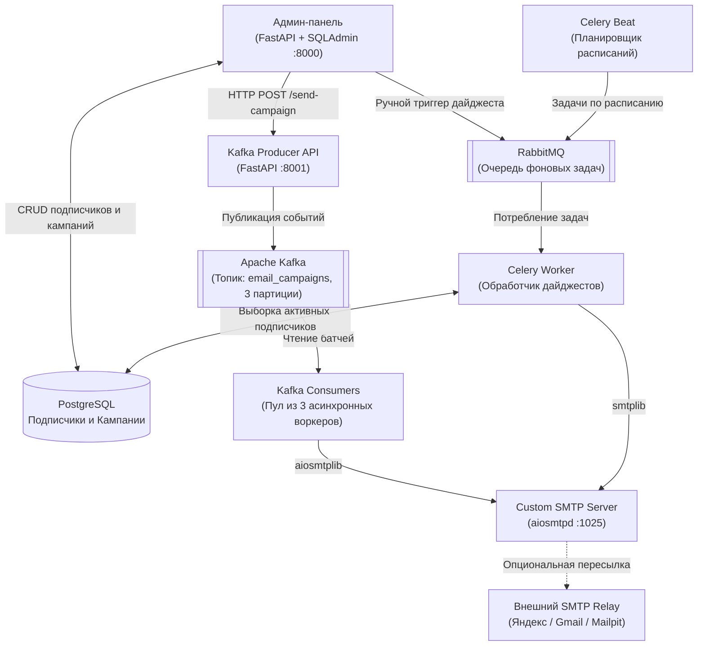

# Event-Driven Email Distribution Platform

Масштабируемая микросервисная платформа для управления email-рассылками, объединяющая **потоковую обработку массовых кампаний (Apache Kafka)**, **периодические задачи по расписанию (Celery Beat + RabbitMQ)**, **единую панель администратора (FastAPI + SQLAdmin)** и **собственный асинхронный SMTP-сервер (aiosmtpd)**.

---

## Архитектура системы

В проекте разделены зоны ответственности между двумя брокерами сообщений:
* **Apache Kafka** отвечает за высоконагруженные потоковые события — мгновенный запуск массовых рассылок по кнопке из Админки с распределением нагрузки между партициями и консьюмерами.
* **RabbitMQ + Celery Beat** отвечает за фоновые задачи и строгое выполнение регулярных дайджестов по расписанию.



---

## Технологический стек

* **Backend & API:** Python 3.12+, FastAPI, Uvicorn, Pydantic v2
* **Админ-панель:** SQLAdmin, Jinja2
* **База данных и ORM:** PostgreSQL 16, SQLAlchemy 2.0, Psycopg 3
* **Брокеры сообщений:** Apache Kafka (Confluent), Zookeeper, RabbitMQ 3
* **Очереди и планировщик:** Celery 5, Celery Beat, `aiokafka`
* **Почтовый сервер:** `aiosmtpd` (собственный SMTP-приемщик), `aiosmtplib`
* **Инфраструктура и тесты:** Docker, Docker Compose, Pytest, `pytest-asyncio`, `httpx2`

---

## Структура проекта

```text
├── admin_app.py          # Единая панель управления (FastAPI + SQLAdmin)
├── main.py               # Сервис массовых рассылок на Kafka (Producer + 3 Consumers)
├── worker.py             # Celery Worker и конфигурация расписания Celery Beat
├── smtp_server.py        # Собственный асинхронный SMTP-сервер (aiosmtpd)
├── models.py             # Общие модели БД SQLAlchemy (Subscriber, Campaign)
├── tests/
│   ├── conftest.py       # Изолированные фикстуры БД (SQLite in-memory)
│   └── test_services.py  # Интеграционные и юнит-тесты всех компонентов
├── Dockerfile            # Общий образ для Python-микросервисов
├── docker-compose.yml    # Оркестрация всех 10 контейнеров системы
├── requirements.txt      # Зависимости проекта
└── pytest.ini            # Конфигурация Pytest
```

---

## Быстрый старт (Docker Compose)

Весь стек (инфраструктура + 5 Python-микросервисов) запускается одной командой.

### 1. Клонирование и запуск
```bash
git clone <URL_вашего_репозитория>
cd <папка_проекта>
docker compose up -d --build
```
*(Если на машине не установлен плагин `docker-buildx`, используйте `COMPOSE_BAKE=false docker compose up -d --build`).*

### 2. Доступные веб-интерфейсы и порты

| Сервис | Адрес | Описание |
| :--- | :--- | :--- |
| **Админ-панель** | `http://localhost:8000/admin` | Управление подписчиками, рассылками и запуск задач |
| **Kafka Email API (Swagger)** | `http://localhost:8001/docs` | REST API для постановки писем в топик Kafka |
| **RabbitMQ Management** | `http://localhost:15672` | Мониторинг очередей Celery (логин/пароль: `guest` / `guest`) |
| **Custom SMTP Server** | `localhost:1025` | Порт приема входящих SMTP-соединений |
| **PostgreSQL** | `localhost:5432` | База данных (`user` / `password` / `dbname`) |

---

## Сценарии использования

1. **Добавление подписчиков:** Откройте `http://localhost:8000/admin` $\rightarrow$ раздел **«Подписчики»** $\rightarrow$ создайте несколько записей с активным статусом (`Is active`).
2. **Автоматический дайджест (Celery Beat + RabbitMQ):** Планировщик автоматически ставит задачу в RabbitMQ, воркер выбирает активных подписчиков из PostgreSQL и отправляет письма через кастомный SMTP-сервер.
3. **Массовая рассылка по кнопке (Apache Kafka):** Перейдите в раздел **«Рассылки (Kafka)»**, создайте HTML-шаблон письма, отметьте его в списке и выберите действие **«Отправить рассылку через Kafka»**.
4. **Просмотр логов доставки SMTP-сервера:**
   ```bash
   docker logs -f custom_smtp_server
   ```

### Настройка реальной доставки (SMTP Relay)
По умолчанию `smtp_server.py` работает в автономном режиме и логирует принятые письма. Для пересылки писем на реальные почтовые ящики (Яндекс, Gmail, Mail.ru) задайте переменные окружения в `docker-compose.yml` для сервиса `smtp-server`:
```yaml
RELAY_HOST: smtp.yandex.ru
RELAY_PORT: 465
RELAY_USER: your_email@yandex.ru
RELAY_PASS: your_app_password
RELAY_USE_TLS: "true"
```

---

## Запуск тестов

Проект покрыт автоматическими тестами на `pytest` (проверка реального SMTP-соединения с `aiosmtpd`, эндпоинтов Kafka Producer, фильтрации подписчиков в Celery и рендеринга страниц Админки):

```bash
# Локально в виртуальном окружении
pytest -v

# Или внутри запущенного Docker-контейнера
docker exec -it admin_panel_service pytest -v
```
